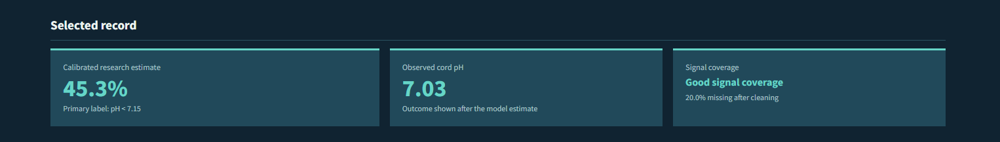
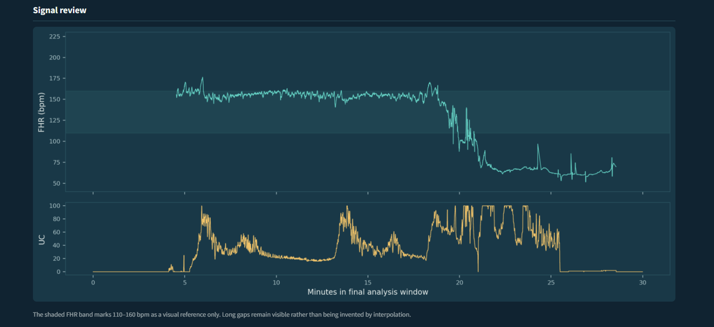
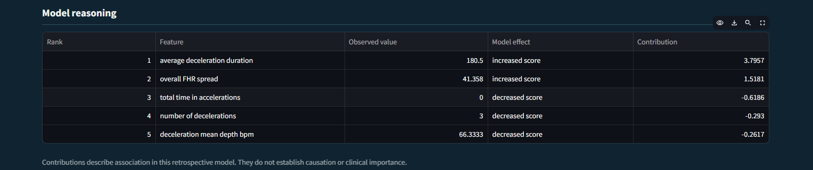
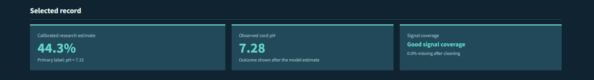
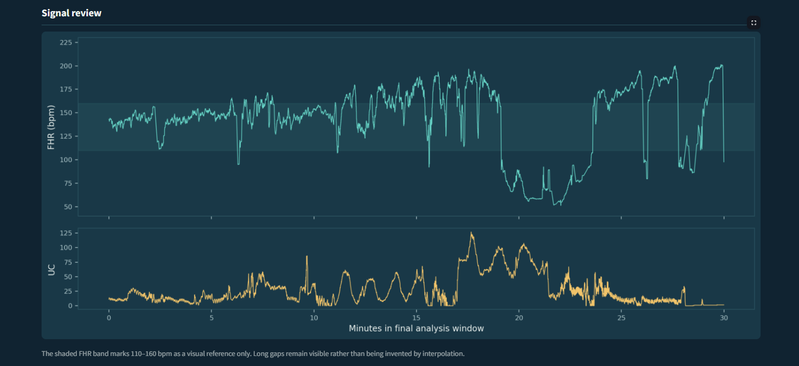
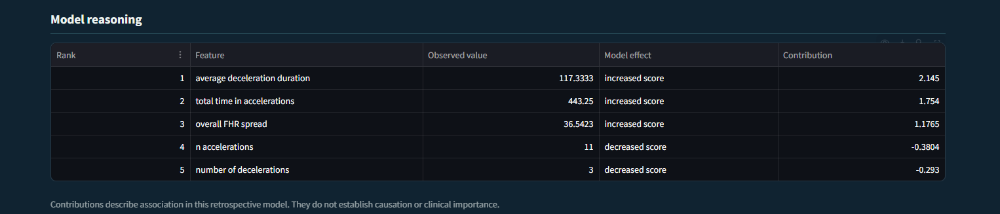
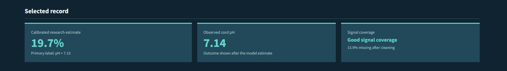
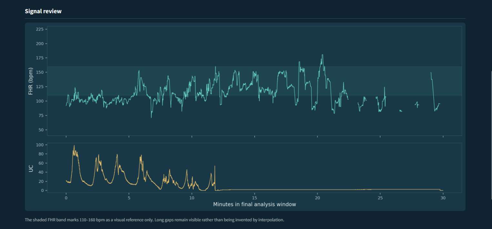
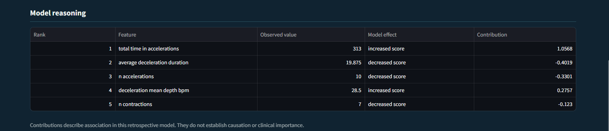

# CTG risk model

An exploratory, explainable prototype for estimating the risk of low umbilical
artery cord-blood pH from the final 30 minutes of cardiotocography (CTG).

> **Research prototype — not for clinical use.**

This project is a transparent modelling study, not a deployable clinical
system. It uses the public CTU-UHB CTG Database: 552 recordings containing
fetal heart rate (FHR), uterine contractions (UC), and delivery metadata.

## Question

Can simple, clinically named measurements from the final 30 minutes of a CTG
trace provide useful retrospective discrimination of low cord pH while keeping
the modelling choices auditable?

The primary label is cord pH `< 7.15`. Sensitivity analyses use `< 7.05` and
`< 7.20`. Cord pH, blood-gas values, Apgar scores, birth weight, neonatal
outcomes, and retrospective delivery variables are excluded from model inputs.

## Results

The primary analysis retained 481 of 552 recordings after the predeclared
final-window signal-quality rule. Repeated stratified 5-fold cross-validation
with 5 repeats was used, with nested 3-fold tuning for trained models.

| Model | ROC-AUC | PR-AUC | Brier |
|---|---:|---:|---:|
| Logistic L2 | 0.756 | 0.441 | 0.203 |
| Logistic L1 | 0.754 | 0.443 | 0.209 |
| Random Forest | 0.745 | 0.405 | 0.155 |
| Prevalence baseline | 0.500 | 0.170 | 0.141 |

The raw logistic score was overconfident relative to prevalence. Leakage-safe
Platt scaling reduced its exploratory Brier score from 0.203 to 0.126 and
aligned mean predicted risk with the observed 0.170 prevalence. These results
are internal estimates and require external validation.

## Reproduce the analysis

Create a Python 3.13 environment, install the pinned dependencies, and place
the PhysioNet files under `data/raw/`. The loader also accepts the nested
directory layout produced by the PhysioNet ZIP archive.

```powershell
python -m venv .venv
.venv\Scripts\Activate.ps1
python -m pip install -r requirements.txt
python run_pipeline.py
pytest -q
```

The pipeline writes processed tables to `data/processed/` and figures to
`reports/figures/`. The notebooks in `notebooks/` are companion exploration
documents; the `.py` files are the reproducible runners.

## Explore the demo

After running the pipeline:

```powershell
streamlit run app.py
```

Choose a recording to inspect its final-window FHR/UC trace, repeated
out-of-fold calibrated risk estimate, and five largest standardized logistic
contributions. Use the sidebar's “Highest model score” view to find
high-scoring records, “Case studies” to revisit the Phase 5 examples, or
record-ID search to jump directly to a recording. The score is an explanatory
research output, not a clinical probability.

## Dashboard walkthrough screenshots

These three records are reserved as representative demo cases:

| Record | Research case | Cord pH | Calibrated score | Why show it |
|---|---|---:|---:|---|
| 1198 | True positive | 7.03 | 45.3% | High model score and low-pH outcome |
| 1035 | False positive | 7.28 | 44.3% | High model score without the low-pH outcome |
| 1488 | False negative | 7.14 | 19.7% | Low-pH outcome just below the exploratory 20% view threshold |

Each record has three screenshot slots: the summary cards, the signal review
graph, and the model-reasoning table. Replace the placeholder images below
with screenshots captured from the Streamlit demo.

### Record 1198 — true positive





### Record 1035 — false positive





### Record 1488 — false negative





## Method

1. **Quality checks:** verify IDs, metadata, pH, sampling rate, and WFDB file
   pairing.
2. **Preprocessing:** select the final 30 minutes; mark FHR outside 50–220 bpm
   as missing; interpolate only internal gaps up to 15 seconds; retain longer
   gaps as missing.
3. **Features:** baseline FHR, variability, accelerations, decelerations,
   approximate late decelerations, contractions, and signal-quality measures.
4. **Models:** prevalence and rule baselines, L1/L2 logistic regression, and
   class-weighted Random Forest.
5. **Explanation:** out-of-fold calibration, standardized coefficients,
   top-five feature stability, and TP/FP/FN case studies.

## Limitations

- The dataset is small and comes from one clinical source; estimates may not
  generalize to other hospitals, devices, populations, or care pathways.
- Cord pH is a retrospective outcome. The model has not been evaluated at a
  real prospective decision point and cannot establish causality.
- Feature extraction is intentionally simplified. Approximate late
  decelerations and UC peak detection are not formal clinical annotations.
- Missingness may reflect acquisition or clinical workflow, not only fetal
  physiology. Signal-quality fields can therefore act as site-specific proxies.
- The case-study threshold of 0.20 is an exploratory visualization choice, not
  a clinical operating threshold.
- No prospective validation, subgroup fairness analysis, decision-curve
  analysis, or prospective alarm-burden analysis has been performed.
- Calibration was assessed internally with repeated out-of-fold predictions;
  it still needs validation on a temporally and geographically separate cohort.

## Next steps with real hospital data

Define the intended decision, time horizon, intervention, and acceptable
false-alarm burden with clinicians. Then pre-register feature and exclusion
rules, obtain temporally separated and multi-site data, validate calibration by
site and subgroup, compare against current CTG practice, and monitor drift and
missingness after deployment. Clinical use would require governance,
prospective evaluation, and appropriate regulatory review.

## Data and citation

Data source: the [CTU-UHB CTG Database on PhysioNet](https://physionet.org/content/ctu-uhb-ctgdb/1.0.0/).

Follow the dataset licence and cite Chudáček et al., “Open access
multivariate cardiotocography database,” *BMC Pregnancy and Childbirth* 2014,
14:16.
